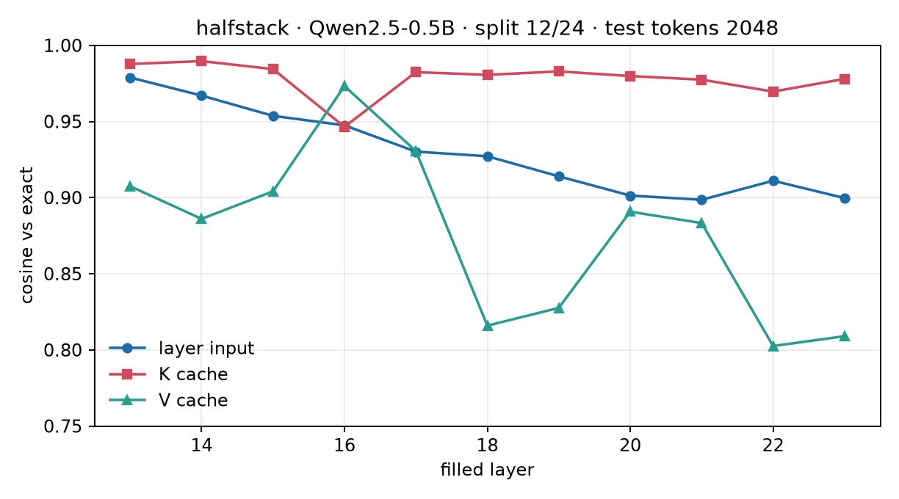

# halfstack

**Can a closed-form map replace the upper half of a prefill?**

RidgeFill ([arXiv:2611.09709](https://arxiv.org/abs/2611.09709)) runs the
prompt through the lower layers, predicts each skipped layer's input from the
split state with a ridge map, and writes that layer's KV cache from the
prediction. Nothing is trained: one capture pass over calibration text and one
closed-form solve per layer.

This repo is Milestone 1: fit the maps on a small model and measure whether
they predict the right inputs and the right cache. The llama.cpp patch and the
TTFT numbers come next.

## Result

Qwen2.5-0.5B, split after **12 of 24 layers**. Calibration: 13.3k train tokens
from *Pride and Prejudice*, 2k validation, 2k test. Lambda selected on
validation; the numbers below are the separate test split.

| metric | mean |
|---|---:|
| input cosine (predicted vs true layer input) | **0.930** |
| K cosine (after the layer's input norm and `k_proj`) | **0.978** |
| V cosine (after the layer's input norm and `v_proj`) | **0.876** |



Input cosine falls from 0.979 at layer 13 to 0.900 at layer 23. K stays near
0.98 across the depth; V is the weak component, which is consistent with the
paper's finding that values carry the error on Qwen models.

The maps are small: 11 layers × 896² parameters × 4 bytes ≈ **35 MB** in fp32,
or about 18 MB in bf16. The cost of applying one is 896² multiply-accumulates
per token, paid once per filled layer.

This is a feasibility result, not a serving result. A cache filled from the
wrong input is wrong for every later token, which is why K/V cosine is the
gate. TTFT and RULER require the engine patch.

## How it works

1. Run the unmodified model over calibration text with `output_hidden_states`.
2. Take `X = hidden_states[split]` and `Y_l = hidden_states[l]` for each late
   layer `l > split`.
3. Fit `x_hat_l = A_l x + b_l` with ridge regression:

   ```
   A = Yc^T Xc (Xc^T Xc + alpha I)^-1
   b = mean(Y) - A mean(X)
   alpha = lambda * trace(Xc^T Xc) / d_in
   ```

4. Score the map on held-out text: input cosine, and the cosine of the K/V the
   layer would write after its own norm and projections.

## Reproduce

```bash
python3 -m venv .venv
.venv/bin/pip install torch --index-url https://download.pytorch.org/whl/cpu
.venv/bin/pip install -r requirements.txt

.venv/bin/python -m pytest tests -q
.venv/bin/python bench/calibrate.py \
  --model Qwen/Qwen2.5-0.5B \
  --text data/pride_and_prejudice.txt \
  --split 12 \
  --out results/calibration_qwen25_0.5b.json
.venv/bin/python bench/plot_calibration.py
```

The capture is CPU-friendly: about 45 seconds for the 0.5B model. Fitting all
six lambdas takes another ~45 seconds.

## What is next

- Splits 16/24 and 18/24, and an 8B model, to see where the map breaks.
- A llama.cpp patch: capture via a build-time hook, skip the upper layers for
  prefix rows, keep a full-precision tail and every decode step exact.
- TTFT and RULER on the RX 9070 XT, where the 16 GB budget decides which split
  is actually deployable.

## Limits

- One model (0.5B), one corpus, one split. This is a feasibility check.
- K/V cosine is measured before RoPE. It scores the map, not the position
  encoding.
- The maps are fitted on the same model they replace; no cross-model transfer
  is tested.
- No speedup is claimed yet. The engine patch is not written.

## Citation

```bibtex
@article{johnston2026ridgefill,
  title   = {RidgeFill: Training-Free Late-Layer Cache Fill for Faster Prefill},
  author  = {Johnston, Dylan and Smith, Robert P.},
  journal = {arXiv preprint arXiv:2611.09709},
  year    = {2026}
}
```
